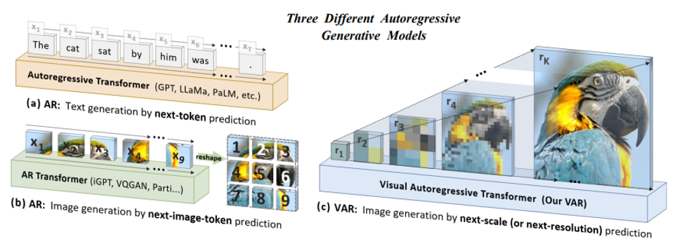
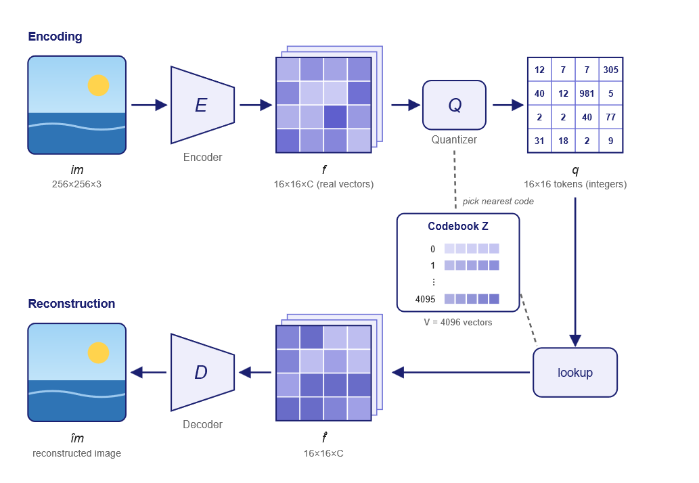
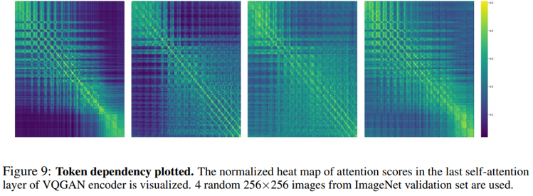
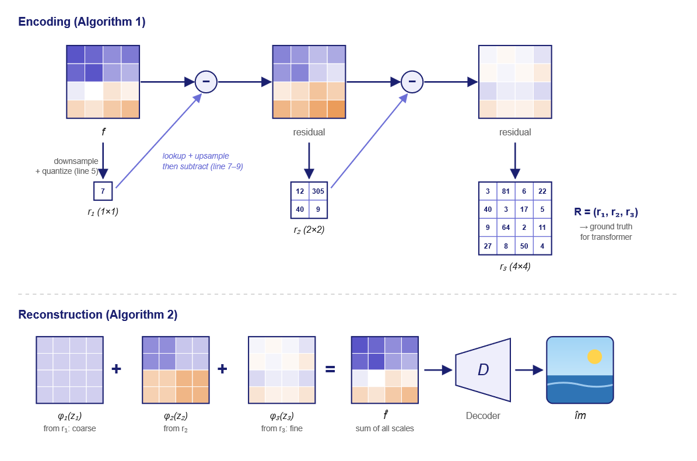
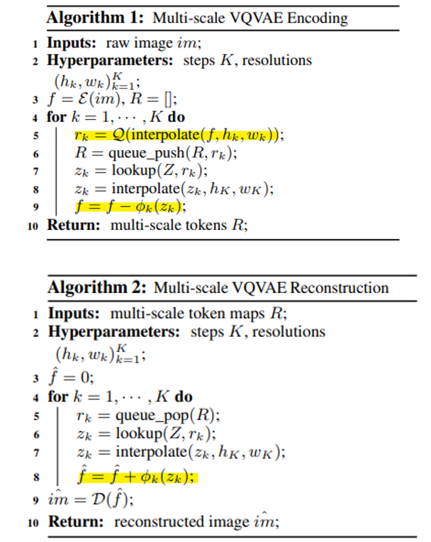
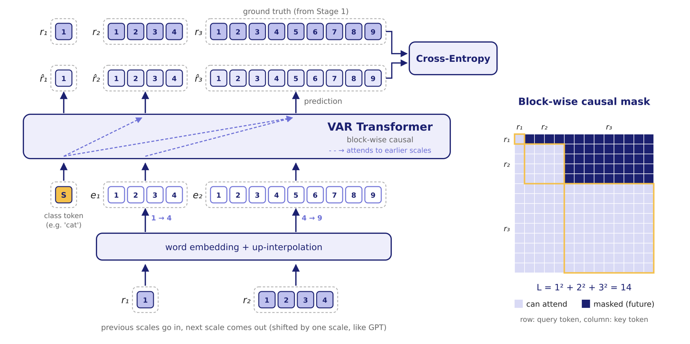
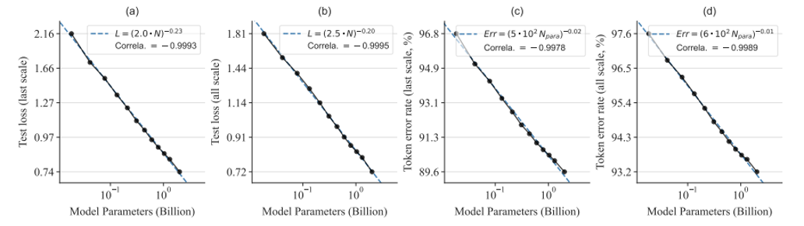
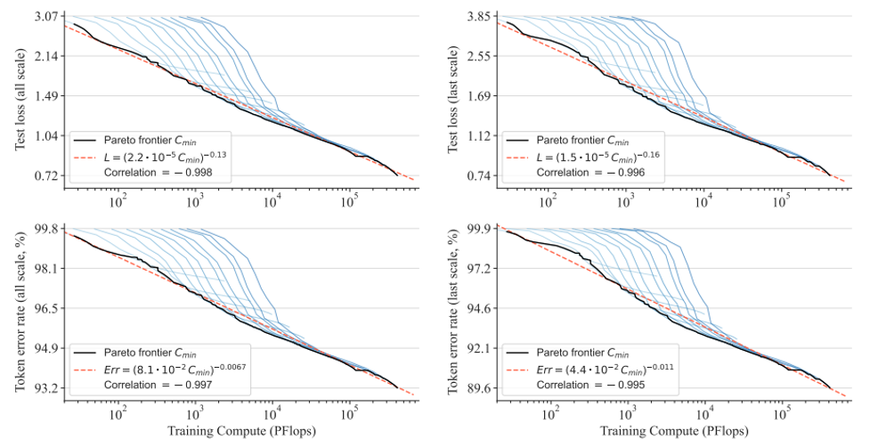
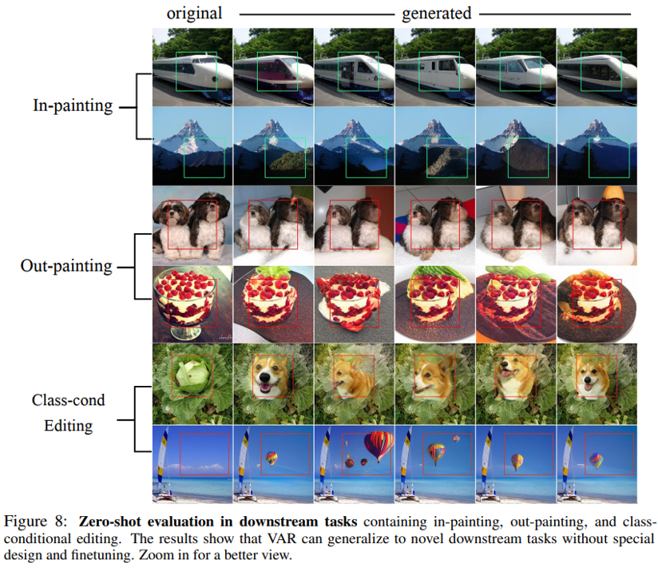

### 논문 한 줄 정리: AR 자체는 그대로 두고, 이미지를 생성하는 순서만 '다음 토큰'에서 '다음 스케일'로 바꾸겠다.

해당 논문은 AIKU 스터디에서 발표한 논문으로, 발표 자료를 정리하며 글로 옮겼습니다.

## Background

VAR 이전에 주류였던 image generation model은 크게 4가지다.

- **GAN** (BigGAN / StyleGAN-XL / GigaGAN): Generator와 Discriminator를 경쟁시키며 학습한다. 빠르지만 학습이 불안정하다.
- **Diffusion Model** (ADM / LDM / DiT): forward 과정에서 noise를 더하고, reverse 과정을 통해 이미지를 생성한다. quality는 높지만 느리다.
- **Masked Prediction Model** (MaskGIT / MUSE / MagViT): BERT 방식으로, masking된 token 여러 개를 동시에 채운다. 병렬로 생성할 수 있다.
- **Raster-scan Autoregressive** (VQGAN / ViT-VQGAN / RQ-Transformer): 이미지를 token으로 바꾼 뒤 2D를 1D로 펴서, GPT처럼 next token을 하나씩 예측한다. LLM과 같은 구조라 scalable하다는 장점이 있지만, 실제로는 느리고 quality도 떨어졌다.

해당 논문에서 주목하는 것은 마지막 **raster-scan AR**이다. 같은 AR 방식인데 text(LLM)에서는 좋은 성능을 보이는 반면, 이미지에서는 그렇지 못했다. 그래서 저자들은 raster-scan AR을 vision에 적용하는 데에 주목했다.

## Motivation

### Why AR?

LLM이 성공한 이유는 크게 Scalability와 Generalization, 두 가지 성질 때문이다.

- **Scalability**: scaling law 덕분에 model을 키웠을 때의 성능을 미리 예측할 수 있다.
- **Generalization**: zero-shot처럼 학습하지 않은 task도 잘 수행한다.

그러면 vision에서도 이런 성질이 나타나지 않을까? 우선 기존 연구에서 여러 시도가 있었는데, 결과는 좋지 못했다. 또한 vision과 관련된 scaling law는 거의 연구되지 않았고, 성능도 diffusion model보다 크게 낮았다. 논문에서는 이를 LLM에 비해 image AR의 힘이 갇혀 있다(locked)고 표현한다.

### Why does AR fail on images?

저자들은 image AR이 locked 되어 있는 원인을 data의 순서(order)에서 찾고자 했다. AR은 data에 순서가 있어야 하는데, text에서 문장 같은 경우는 왼쪽에서 오른쪽으로 읽는 순서가 자연스럽다. 근데 이미지는 2D를 1D로 펴는 raster 순서가 정말 맞는 순서일까?

실제로 이미지를 1D로 펴면 위아래로 붙어 있던 token이 멀어져 2D 구조가 깨지고, token을 하나씩 생성하니 느리다.

### Humans see images coarse-to-fine

그래서 저자들은 사람이 이미지를 보는 방식에 주목했다. 사람은 전체 구조를 먼저 파악하고, 세부는 나중에 본다. 즉, **coarse-to-fine** 방식으로 본다.

→ 이를 바탕으로 image AR의 새로운 순서로 **next-scale prediction**, 즉 저해상도에서 고해상도로 생성하는 방식을 논문에서 제안한다.



## Preliminary

### Tokenization (VQGAN)

VAR을 설명하기 전에, 이미지를 AR로 생성하려면 어떻게 해야 하는지 VQGAN의 방식을 먼저 살펴보자.



$$
f = \mathcal{E}(im), \quad q = \mathcal{Q}(f)
$$

encoder $\mathcal{E}$가 $256 \times 256 \times 3$ 이미지를 $16 \times 16 \times C$ 크기의 feature map $f$로 압축하고, quantizer $\mathcal{Q}$가 이를 $16 \times 16$ 크기의 token map $q$로 바꾼다. 이렇게 하면 이미지도 text처럼 token의 나열이 되어, GPT 같은 model에 넣을 수 있게 된다.

quantization은 feature map의 각 칸마다 codebook $Z$에서 가장 가까운 vector의 index를 고르는 방식이다. 이 index가 곧 token이다.

$$
q^{(i,j)} = \underset{v \in [V]}{\arg\min} \left\| \mathrm{lookup}(Z, v) - f^{(i,j)} \right\|_2
$$

reconstruction은 반대로, index를 codebook에서 찾아(lookup) 다시 vector로 바꾸고, decoder $\mathcal{D}$에 넣어 이미지를 생성한다.

$$
\hat{f} = \mathrm{lookup}(Z, q), \quad \hat{im} = \mathcal{D}(\hat{f})
$$

$$
\mathcal{L} = \| im - \hat{im} \|_2 + \| f - \hat{f} \|_2 + \lambda_P \mathcal{L}_P(\hat{im}) + \lambda_G \mathcal{L}_G(\hat{im})
$$

($\mathcal{L}_P$는 perceptual loss, $\mathcal{L}_G$는 GAN의 discriminator loss다.)

이렇게 만든 token map을 한 줄로 펴서 next token을 예측하는 것이 기존 AR 방식인데, 저자들은 여기에 4가지 문제가 있다고 지적한다.

### Weakness of Raster-scan AR

**1. Mathematical premise violation**

기존 raster AR은 각 token이 앞에 나온 token(prefix)에만 의존한다고 가정한다. 그런데 실제 이미지는 그렇지 않다. 예를 들어 한 이미지에 하늘과 바다가 있으면 이 둘은 서로 연관이 있는데, raster AR은 하늘을 만들 때 바다를 보지 못한 채로 생성한다. (왼쪽 위부터 오른쪽 아래로 토큰을 생성하기 때문이다.)



위의 사진은 VQGAN encoder에서 token끼리 서로를 얼마나 참고하는지 나타낸 heat map이다. 밝을수록 많이 참고한다는 뜻인데, 대각선 앞뒤 가리지 않고 전체적으로 밝게 퍼져 있다. 즉, token은 앞쪽뿐 아니라 뒤쪽과도 연결되어 있다. (bidirectional) → 그런데 기존 AR은 한 방향(unidirectional)으로만 의존한다고 가정하고 토큰을 생성한다.

**2. Inability to perform some zero-shot generalization**

첫 번째와 같은 원인에서 나오는 문제다. 기존 AR은 한 방향으로만 생성하다 보니, 이미지 아래쪽을 보고 위쪽을 채우는 것처럼 양방향 추론이 필요한 task는 할 수 없다.

**3. Structural degradation**

앞서 말했듯 2D를 1D로 펴는 과정에서, 원래 위아래로 붙어 있던 token이 떨어지게 된다. 그래서 spatial locality가 깨진다.

**4. Inefficiency**

$n \times n$ token을 하나씩 생성하니 $O(n^2)$ step이 필요하고, 전체 연산량은 $O(n^6)$까지 늘어난다.

그래서 VAR은 이 문제들을 해결하기 위해 생성 순서 자체를 바꾼다.

## Method

$$
p(r_1, r_2, \dots, r_K) = \prod_{k=1}^{K} p(r_k \mid r_1, r_2, \dots, r_{k-1})
$$

위 식처럼 VAR은 token 하나가 아니라, 해상도 단위의 token map $r_1, r_2, \dots, r_K$를 순서대로 예측한다. 그러려면 먼저 이미지를 여러 해상도의 token map으로 쪼개야 하는데, 이걸 하는 게 Stage 1의 multi-scale VQVAE다. 그리고 이 token map들을 예측하도록 학습하는 게 Stage 2의 VAR Transformer다.

Stage 1과 2로 단계를 나눈 이유로, Stage 1은 기존의 이미지를 scale token으로 바꾸는 작업(데이터 전처리, label 생성), Stage 2는 Stage 1에서 생성된 scale token을 transformer에 태우는 작업으로 나누고자 했던 것이 아닐까 생각한다.

### Stage 1: Multi-scale VQVAE

구조는 VQGAN과 같고, quantization 부분만 바뀐다.





위쪽 그림이 encoding 과정이다.

1. feature map $f$를 $1 \times 1$로 줄여서 quantize하면 $r_1$이 나온다. (Algorithm 1의 5번 줄)
2. $r_1$을 다시 원래 크기로 키워서 $f$에서 빼면, $r_1$이 표현하지 못한 나머지, 즉 residual이 남는다. (9번 줄)
3. 이 residual을 $2 \times 2$로 줄여 quantize하면 $r_2$가 되고, 이 과정을 반복한다.

그래서 각 scale은 앞 scale들이 놓친 부분만 담당하게 된다.

아래 그림은 reconstruction 과정이다. (Algorithm 2의 8번 줄) encoding에서 뺀 걸 그대로 다시 더하는데, $r_1$에서 나온 건 밑그림, $r_2$는 큰 덩어리, $r_3$는 세부 디테일이라고 보면 된다. $r_1, r_2, r_3$를 다 더하면 원래의 feature map $\hat{f}$가 되고, 이를 decoder에 통과시켜 이미지를 생성한다.

참고로 모든 scale이 codebook 하나를 공유하고, upsampling할 때 생기는 정보 손실은 $\phi_k$라는 작은 convolution layer로 보정한다.

이렇게 얻은 $R$, 즉 $r_1$부터 $r_K$까지가 Stage 2 transformer가 맞혀야 할 정답(ground truth)이 된다.

### Stage 2: VAR Transformer

Stage 2에서는 앞에서 만든 token map들을 GPT-2 style의 transformer로 학습한다.



- 맨 아래 $r_1, r_2$를 embedding한 뒤 다음 scale 크기로 키운다. $r_1$의 1칸은 4칸짜리 $e_1$이 되고, $r_2$의 4칸은 9칸짜리 $e_2$가 된다. 키우는 이유는 다음 scale의 칸 수만큼 output을 내야 하기 때문이다.
- 여기에 class 정보를 담은 start token $[S]$를 앞에 붙여, $[S], e_1, e_2$를 한 줄로 이어 transformer에 한 번에 넣는다.
- 그러면 $[S]$ 자리에서 $r_1$을, $e_1$ 자리에서 $r_2$를, $e_2$ 자리에서 $r_3$를 동시에 예측한다.
- 점선처럼 각 scale은 앞의 모든 scale을 참고하고, 각 prediction은 Stage 1에서 만든 정답과 비교해 cross-entropy로 학습한다.

GPT처럼 한 칸씩 밀려 있는 구조인데, 그 단위가 token이 아니라 scale인 것이다. 이전 scale이 들어가고, 다음 scale이 나온다. 학습 때는 정답을 input으로 넣기 때문에 모든 scale을 한 번에 학습할 수 있다.

같은 scale 안의 token끼리는 서로 다 보고 이전 scale도 볼 수 있지만, 다음 scale은 볼 수 없도록 scale 단위로 masking한다. (그림 예시에서 전체 길이는 $L = 1^2 + 2^2 + 3^2 = 14$)

실제로 이미지를 생성할 때는 $[S]$에서 $r_1$을 만들고, 그걸 넣어 $r_2$를 만드는 식으로 scale별로 순서대로 진행한다. 대신 **한 scale 안의 token은 병렬로 한 번에 생성**하기 때문에, 적은 step으로 이미지 하나를 완성할 수 있다. 논문에서는 이를 통해 연산량이 $O(n^6)$에서 $O(n^4)$로 줄어든다고 한다.

## Experiments

### ImageNet 256×256

ImageNet 256×256 class-conditional generation 결과다. 먼저 지표를 보면,

- **FID**: 생성한 이미지들의 분포가 실제 이미지 분포와 얼마나 가까운지. 낮을수록 좋다.
- **IS**: 생성한 이미지가 얼마나 선명하고 다양한지. 높을수록 좋다.
- **#Step**: 이미지 하나를 만드는 데 필요한 model 실행 횟수
- **Time**: VAR 대비 상대적인 inference time

```table-config
align=center
```

| Type | Model | FID↓ | IS↑ | Pre↑ | Rec↑ | #Para | #Step | Time |
| --- | --- | --- | --- | --- | --- | --- | --- | --- |
| GAN | BigGAN | 6.95 | 224.5 | **0.89** | 0.38 | 112M | 1 | – |
| GAN | GigaGAN | 3.45 | 225.5 | 0.84 | **0.61** | 569M | 1 | – |
| GAN | StyleGan-XL | 2.30 | 265.1 | 0.78 | 0.53 | 166M | 1 | 0.3 |
| Diff. | ADM | 10.94 | 101.0 | 0.69 | 0.63 | 554M | 250 | 168 |
| Diff. | CDM | 4.88 | 158.7 | – | – | – | 8100 | – |
| Diff. | LDM-4-G | 3.60 | 247.7 | – | – | 400M | 250 | – |
| Diff. | DiT-L/2 | 5.02 | 167.2 | 0.75 | 0.57 | 458M | 250 | 31 |
| Diff. | DiT-XL/2 | 2.27 | 278.2 | 0.83 | 0.57 | 675M | 250 | 45 |
| Diff. | L-DiT-3B | 2.10 | 304.4 | 0.82 | 0.60 | 3.0B | 250 | >45 |
| Diff. | L-DiT-7B | 2.28 | 316.2 | 0.83 | 0.58 | 7.0B | 250 | >45 |
| Mask. | MaskGIT | 6.18 | 182.1 | 0.80 | 0.51 | 227M | 8 | 0.5 |
| Mask. | RCG (cond.) | 3.49 | 215.5 | – | – | 502M | 20 | 1.9 |
| AR | VQVAE-2† | 31.11 | ~45 | 0.36 | 0.57 | 13.5B | 5120 | – |
| AR | VQGAN† | 18.65 | 80.4 | 0.78 | 0.26 | 227M | 256 | 19 |
| AR | VQGAN | 15.78 | 74.3 | – | – | 1.4B | 256 | 24 |
| AR | VQGAN-re | 5.20 | 280.3 | – | – | 1.4B | 256 | 24 |
| AR | ViTVQ | 4.17 | 175.1 | – | – | 1.7B | 1024 | >24 |
| AR | ViTVQ-re | 3.04 | 227.4 | – | – | 1.7B | 1024 | >24 |
| AR | RQTran. | 7.55 | 134.0 | – | – | 3.8B | 68 | 21 |
| AR | RQTran.-re | 3.80 | 323.7 | – | – | 3.8B | 68 | 21 |
| VAR | VAR-d16 | 3.30 | 274.4 | 0.84 | 0.51 | 310M | 10 | 0.4 |
| VAR | VAR-d20 | 2.57 | 302.6 | 0.83 | 0.56 | 600M | 10 | 0.5 |
| VAR | VAR-d24 | 2.09 | 312.9 | 0.82 | 0.59 | 1.0B | 10 | 0.6 |
| VAR | VAR-d30 | 1.92 | 323.1 | 0.82 | 0.59 | 2.0B | 10 | 1 |
| VAR | VAR-d30-re | **1.73** | **350.2** | 0.82 | 0.60 | 2.0B | 10 | 1 |
| | (validation data) | 1.78 | 236.9 | 0.75 | 0.67 | | | |

(†: MaskGIT에서 인용한 값, -re: rejection sampling을 사용한 결과)

VAR은 model 크기에 비해 뛰어난 성능을 보인다.

예를 들어 VAR-d20(600M)과 비슷한 크기인 DiT-XL/2(675M)를 비교해 보면, FID는 2.57 대 2.27로 VAR이 약간 떨어지고, IS는 302.6 대 278.2로 VAR이 약간 높다. 하지만 Step은 10 대 250, Time은 0.5 대 45로 VAR이 훨씬 효율적이다.

그리고 가장 큰 VAR-d30-re는 FID 1.73, IS 350.2로 표에서 가장 좋은 성능, 즉 SOTA를 기록했다. (-re는 생성한 것 중 좋은 것을 고르는 rejection sampling을 쓴 결과인데, 쓰지 않은 VAR-d30도 1.92로 DiT보다 좋다.)

또 diffusion model인 DiT는 크기를 키워도 FID가 2.27 → 2.10 → 2.28로, 어느 순간 더 좋아지지 않는다. 반면 VAR은 d16부터 d30까지 3.30 → 2.57 → 2.09 → 1.92로 parameter를 키울수록 꾸준히 좋아진다. scalable하다는 걸 표에서도 확인할 수 있다.

개인적으로는 성능보다도 Step과 Time이 압도적으로 적다는 점이 가장 인상적이었다.

### ImageNet 512×512

```table-config
align=center width=fit
```

| Type | Model | FID↓ | IS↑ | Time |
| --- | --- | --- | --- | --- |
| GAN | BigGAN | 8.43 | 177.9 | – |
| Diff. | ADM | 23.24 | 101.0 | – |
| Diff. | DiT-XL/2 | 3.04 | 240.8 | 81 |
| Mask. | MaskGIT | 7.32 | 156.0 | 0.5† |
| AR | VQGAN | 26.52 | 66.8 | 25† |
| VAR | VAR-d36-s | **2.63** | **303.2** | 1 |

(†: MaskGIT에서 인용한 값, -s: resource 한계로 AdaLN layer 하나를 공유한 model)

이미지 해상도를 512×512로 올려도 VAR-d36-s의 FID가 2.63으로 DiT-XL/2(3.04)보다 좋고, 더 빠르다. 해상도가 높아져도 VAR의 이점이 유지되는 것을 확인할 수 있다.

### Scaling Laws

다음은 VAR이 LLM처럼 scalable한지에 대한 실험이다. 18M부터 2B까지 12개 크기의 model을 학습해서 측정했다고 한다.



model size $N$에 따른 test loss와 token error rate다. log scale로 그리면 거의 완벽한 직선이 나오고, correlation이 −0.998 정도다. → $N$이 커질수록 test loss와 token error가 줄어든다.



training compute $C$에 따른 결과에서도 마찬가지로 직선 관계가 나온다.

이를 보아 LLM의 scalability를 image generation에서도 보여줬다고 할 수 있다.

### Zero-shot Generalization

VAR은 image generation만 학습했는데, 추가 학습이나 architecture 변경 없이 다른 task도 수행할 수 있었다고 한다.



- **In-painting**: box 영역 안쪽을 채우는 task
- **Out-painting**: 반대로 box 바깥쪽을 새로 그리는 task
- **Class-conditional editing**: box 영역 안의 token만 원하는 class로 생성하는 task

위의 세 task는 남겨 둘 부분은 원본 token을 그대로 넣고, 채울 부분만 model이 생성하는 방식이다. 결과를 보면 주변과 자연스럽게 어울린다. 앞서 기존 AR은 아래쪽을 보고 위쪽을 채우지 못한다고 했는데, VAR은 이러한 task가 가능하다는 것을 확인할 수 있다.

### Ablation Study

```table-config
align=center
```

| Description | Para. | Model | AdaLN | Top-k | CFG | Cost | FID↓ | Δ |
| --- | --- | --- | --- | --- | --- | --- | --- | --- |
| AR | 227M | AR | ✗ | ✗ | ✗ | 1 | 18.65 | 0.00 |
| AR to VAR | 207M | VAR-d16 | ✗ | ✗ | ✗ | 0.013 | 5.22 | −13.43 |
| +AdaLN | 310M | VAR-d16 | ✓ | ✗ | ✗ | 0.016 | 4.95 | −13.70 |
| +Top-k | 310M | VAR-d16 | ✓ | 600 | ✗ | 0.016 | 4.64 | −14.01 |
| +CFG | 310M | VAR-d16 | ✓ | 600 | 2.0 | 0.022 | 3.60 | −15.05 |
| +Attn. Norm. | 310M | VAR-d16 | ✓ | 600 | 2.0 | 0.022 | 3.30 | −15.35 |
| +Scale up | 2.0B | VAR-d30 | ✓ | 600 | 2.0 | 0.052 | 1.73 | −16.85 |

간단하게 보면, AR을 VAR로 바꾸기만 해도 FID가 18.65 → 5.22로 크게 떨어지고, inference cost는 0.013배로 줄었다. 첫 두 줄은 아무 추가 기법 없이 GPT-2 style transformer를 AR과 VAR로 각각 학습한 결과라, 생성 순서만 바꾼 효과라고 보면 된다. 이후 AdaLN, top-$k$, CFG, attention normalization을 하나씩 더하고 model을 키우면 FID 1.73까지 내려간다.

## Limitations & Discussion

### From authors

- tokenizer를 VQGAN 구조 그대로 두고 개선하지 않았다.
- text prompt로 이미지를 만드는 text-to-image나 video generation은 아직 하지 않았다.

### From review

- **Missing Ablation Studies**: VQ-VAE 부분, 특히 residual quantization이 VAR 성능에 얼마나 영향을 주는지에 대한 ablation이 없다.
- **Comparison to Stronger Baselines**: MDTv2 같은 더 강한 diffusion baseline과 비교하지 않았다.

### My thoughts

논문은 residual 방식을 고른 이유로 independent interpolation보다 empirically 더 좋았다는 한 문장만 적고 넘어간다. 왜 더 좋은지에 대한 설명이 없어서 개인적으로 아쉬웠다.

## 정리

- VAR은 AR 자체는 그대로 두고, 이미지를 생성하는 순서만 next-scale prediction으로 바꿨다.
- Stage 1(multi-scale VQVAE)에서 이미지를 residual 방식으로 여러 해상도의 token map으로 나누고, Stage 2(VAR Transformer)에서 이전 scale들을 보고 다음 scale을 한 번에 예측한다.
- GPT style의 AR이 처음으로 diffusion을 넘어섰다.
- LLM의 두 가지 성질인 scaling law와 zero-shot generalization을 image generation에서도 볼 수 있었다.
